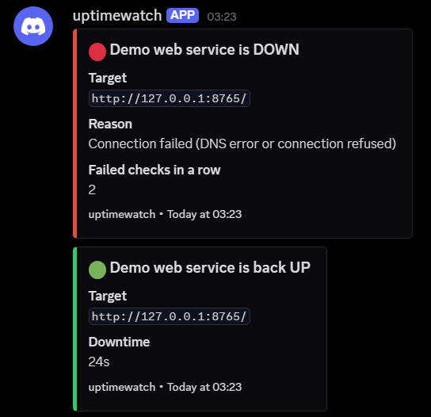

# uptimewatch

[](https://github.com/w44mwtksn4-blip/uptimewatch/actions/workflows/tests.yml)


A small uptime monitor. It checks HTTP(S) URLs and TCP ports, and posts to a Discord webhook **only when something changes**: a service going down, or coming back up. No repeat alerts, no noise.

## Features

- HTTP/HTTPS checks, with an optional expected status code.
- TCP checks (can a connection be opened to `host:port`?).
- A check is only declared **DOWN after N consecutive failures**, so a single dropped request does not wake anyone up.
- One red embed when a check goes down (with the reason) and one green embed when it recovers (with the total downtime).
- Failed notifications are retried on the next round, and Discord rate limits (HTTP 429) are respected.
- Never crashes: errors in a single check or notification are logged and the loop carries on.
- Logs to the console and to a rotating file (`logs/monitor.log`).
- State is saved to a small JSON file, so it works both as a long-running service and as a one-shot job (`--once`) under Task Scheduler or cron.
- The webhook URL lives in a `.env` file, never in the code or the config.

## Install

Requires Python 3.11 or newer.

```bash
git clone https://github.com/w44mwtksn4-blip/uptimewatch.git
cd uptimewatch
python -m venv .venv
# Windows:  .venv\Scripts\activate        Linux/macOS:  source .venv/bin/activate
pip install -e .
```

## Configure

```bash
cp config.example.yaml config.yaml     # Windows: copy config.example.yaml config.yaml
cp .env.example .env                   # Windows: copy .env.example .env
```

1. Create a webhook in Discord: **Server Settings → Integrations → Webhooks → New Webhook → Copy Webhook URL**.
2. Paste it into `.env`:

   ```
   DISCORD_WEBHOOK_URL=https://discord.com/api/webhooks/...
   ```

   `.env` is read from the same folder as `config.yaml` and is ignored by Git. A real environment variable named `DISCORD_WEBHOOK_URL` takes precedence over the file. Treat the URL like a password: anyone who has it can post to your channel.
3. Edit `config.yaml`:

```yaml
interval: 60            # seconds between check rounds (continuous mode)
timeout: 10             # seconds before a single check counts as failed
failure_threshold: 3    # consecutive failures before a check is declared DOWN

checks:
  - name: Example website
    type: http
    url: https://example.com            # healthy = any status below 400

  - name: Example API health
    type: http
    url: https://example.com/health
    expected_status: 200                # healthy = exactly this status

  - name: Example SSH
    type: tcp
    host: example.com
    port: 22
    failure_threshold: 2                # optional per-check override
```

The config is validated at start-up. Mistakes (unknown options, bad ports, duplicate names and so on) stop the program with a clear message and exit code 2.

The check name and target are shown in Discord, so do not put secrets (API keys in query strings, for example) in a `url`.

## Run

```bash
python -m uptimewatch                    # continuous mode, Ctrl+C to stop
python -m uptimewatch --once             # run every check once, then exit
python -m uptimewatch --config /path/to/config.yaml
python -m uptimewatch --help
```

| Option | Meaning |
| --- | --- |
| `-c`, `--config` | Config file (default `./config.yaml`). |
| `--once` | Single round, then exit. Use this with Task Scheduler or cron. |
| `--state-file` | State file (default `state.json` next to the config file). |
| `--log-file` | Log file (default `logs/monitor.log` next to the config file). |
| `--log-level` | `DEBUG`, `INFO` (default), `WARNING` or `ERROR`. |
| `--version` | Print the version and exit. |

The `.env`, `state.json` and `logs/` paths are all resolved relative to the **config file's folder**, so the program behaves the same whatever its working directory is.

Exit codes: `0` normal exit, `2` configuration error.

## Running on Windows

### Option 1: Task Scheduler (one run per minute)

In `--once` mode the `interval` setting is ignored, because Task Scheduler decides how often it runs. The failure threshold then counts *runs*: with a one-minute schedule and `failure_threshold: 3`, a service is reported down after about three minutes.

1. Open **Task Scheduler → Create Task…**
2. **Triggers → New…**: *Daily*, then tick *Repeat task every* **1 minute** *for a duration of* **Indefinitely**.
3. **Actions → New…** (use absolute paths):
   - Program/script: `C:\uptimewatch\.venv\Scripts\python.exe`
   - Add arguments: `-m uptimewatch --once --config C:\uptimewatch\config.yaml`
   - Start in: `C:\uptimewatch`
4. **Settings**: tick *Do not start a new instance if the task is already running*.
5. On the **General** tab, choose *Run whether user is logged on or not* if it should survive logging out.

### Option 2: Windows service with NSSM

Continuous mode runs well as a service using [NSSM](https://nssm.cc/). In an administrator prompt:

```bat
nssm install uptimewatch "C:\uptimewatch\.venv\Scripts\python.exe" "-m uptimewatch --config C:\uptimewatch\config.yaml"
nssm set uptimewatch AppDirectory C:\uptimewatch
nssm set uptimewatch Start SERVICE_AUTO_START
nssm start uptimewatch
```

Logs go to `C:\uptimewatch\logs\monitor.log`. When the service is stopped, uptimewatch finishes the current check, saves its state and exits.

## Example notification

Discord renders each alert as an embed with a coloured side bar. This is an **illustrative text mock-up**, not a screenshot:

```
┃ 🔴 Example API health is DOWN
┃ Target
┃ `https://example.com/health`
┃ Reason
┃ HTTP 503
┃ Failed checks in a row
┃ 3
┃ uptimewatch • today at 14:02
```

```
┃ 🟢 Example API health is back UP
┃ Target
┃ `https://example.com/health`
┃ Downtime
┃ 4m 12s
┃ uptimewatch • today at 14:06
```

<!-- SCREENSHOT PLACEHOLDER
     Add a real screenshot of a Discord notification at docs/notification.png,
     then replace the line below with:  
-->
> 📸 *A real Discord screenshot will be added here (`docs/notification.png`).*

## How it works (architecture)

```
config.yaml ─► config.py ─┐
                          ▼
.env ─────────────────► monitor.py ──► checks.py    run one check, return ok/error
                          │  ▲
                          │  └──────── state.py     pure state machine + JSON file
                          └─────────► notifier.py   build the embed, POST to Discord
__main__.py   command line, signals, wiring        logging_setup.py   console + rotating file
```

1. `config.py` loads `config.yaml` and validates it into small frozen dataclasses.
2. `checks.py` runs one HTTP or TCP check and returns a result. It never raises.
3. `state.py` holds the state machine: `apply_result(previous_state, result, threshold)` returns the new state and, only on a real change, a `Transition`. It is a pure function, which is what the tests exercise.
4. `notifier.py` turns a transition into a red or green embed and posts it. Failures are logged (without the webhook URL) and never raised. A single 429 response is honoured by waiting for `retry_after` (at most 10 seconds).
5. `monitor.py` ties it together: run each check, update the state, notify on change. If a notification fails, the transition is not recorded, so it is attempted again on the next round.
6. `__main__.py` handles the command line, loads `.env`, and turns Ctrl+C or a service stop into a clean shutdown.

State is stored in `state.json` after every round. If the file is missing or damaged, the monitor simply starts afresh, assuming every check is up.

Notes: checks run one after another, so a round can take up to `timeout × number of checks` in the worst case. The downtime shown on recovery is measured from the first failed check of the outage, not from the moment the alert was sent.

## Project layout

```
uptimewatch/
├── src/uptimewatch/
│   ├── __main__.py        # CLI entry point
│   ├── config.py          # load + validate config.yaml
│   ├── checks.py          # HTTP and TCP checks
│   ├── state.py           # state machine + JSON persistence
│   ├── notifier.py        # Discord embeds + webhook delivery
│   ├── monitor.py         # run_once / run_forever
│   └── logging_setup.py   # console + rotating file logging
├── tests/                 # pytest suite
├── config.example.yaml
├── .env.example
├── requirements.txt
├── requirements-dev.txt
├── pyproject.toml
└── LICENSE
```

## Development

```bash
pip install -r requirements-dev.txt
pytest
ruff check .
```

## Licence

[MIT](LICENSE) © 2026 nullbyte
